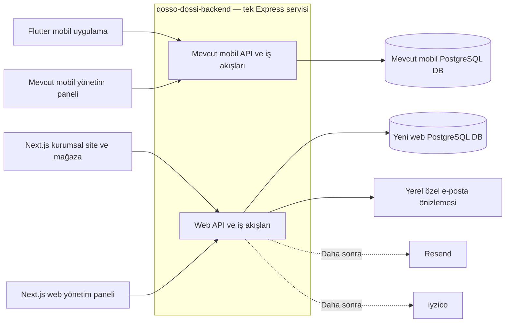

# Dosso Dossi web sitesi ve online mağaza planı

Güncelleme: 14 Ekim 2026. Durum: TR/EN ana sayfa ve mağaza, ayrı web PostgreSQL altyapısı, ürün paneli ve müşteri üyeliği hazırdır. Hesaba bağlı kalıcı sepet, Türkiye teslimat adresleri ve yönetim panelinden kargo ücretleri de yerel kabul kontrolleriyle tamamlandı. Resend etkin değil; yalnız özel yerel e-posta önizlemesi kullanılıyor. Test siparişi, stok rezervasyonu, yönetici sipariş takibi ve iyzico sandbox adaptörü eklenmiştir. Gerçek sandbox uçtan uca testi anahtarları bekler; canlı ödeme, iadeler, SMS ve taşıyıcı entegrasyonu sonraki aşamalardır. Kurulum ve doğrulama sonuçları: [WEB_DEVELOPMENT.md](WEB_DEVELOPMENT.md).

Next.js ile hazırlanacak kurumsal site ve online mağaza, mevcut `dosso-dossi-backend` üzerinden çalışacak. Mobil uygulama mevcut PostgreSQL veritabanını kullanmaya devam edecek; web için ayrı PostgreSQL veritabanı, kullanıcı hesapları, katalog, stok ve sipariş kayıtları kurulacak. Bu karar, önceki hazırlık notlarındaki “bağımsız web mağazası” ifadesinin veri ve iş akışları açısından bağımsızlık anlamına geldiğini netleştirir.

## Onaylanan kapsam

| Konu | Karar |
| --- | --- |
| Tasarım | Espressolab referansına yakın sayfa düzeni ve alışveriş deneyimi, Dosso Dossi marka kimliği |
| Ön yüz | Next.js; kurumsal ana sayfa `/`, online mağaza `/alisveris` |
| Diller | Türkçe ve İngilizce; dil değişimi para birimini veya teslimat ülkesini değiştirmez |
| Kurumsal sayfalar | Ana sayfa, hakkımızda, şubeler, kafe menüsü, iletişim, franchising başvurusu |
| Backend | Mevcut Express ve TypeScript projesi `dosso-dossi-backend`; ayrı web modülleri |
| Veritabanı | Mobil ve web için iki ayrı PostgreSQL veritabanı |
| Üyelik | Satın alma için üyelik ve doğrulanmış e-posta; e-posta/şifre akışı yerel önizlemeyle geliştirildi, Resend alan adı/gönderen erişiminden sonra açılacak |
| Sonraki giriş yöntemi | Sağlayıcı bilgileri geldikten sonra telefon ve SMS kodu |
| Satış | Yalnız Türkiye, Türk lirası, kargo teslimatı |
| Sepet ve adres | Doğrulanmış web hesabına bağlı kalıcı sepet ve Türkiye adresleri; misafir sepeti/birleştirme yok |
| Kargo fiyatı | ADMIN panelinden sabit TL ücret, isteğe bağlı ücretsiz kargo eşiği ve aktiflik; gerçek tarife gelene kadar ücret/eşik boş |
| Ürünler | Renk seçenekli termoslar; gramaj ve uygun öğütme seçenekli paket kahveler |
| Ödeme | iyzico; entegrasyon bilgileri bekleniyor |
| Yönetim | Web verilerini yöneten ayrı panel; ayrıntılı ürün, stok, sipariş, kargo ve içerik yönetimi |
| Görseller | Projedeki uygun marka/ürün görselleri ve yeni site için hazırlanacak görseller; eski web sitesinden yalnız CEO fotoğrafı |
| Metinler | Eski siteden kurumsal içerik kaynağı; hukuki metinleri firma revize edecek |
| Çalışma ortamı | Önce yerel geliştirme; alan adı ve yayın erişimleri daha sonra sağlanacak |

İlk sürümde mobil hesap eşleştirme, cüzdan/damga/POS bağlantısı, katalog veya stok senkronizasyonu, şubeden teslim, yurtdışı satış ve farklı para birimleri bulunmayacak. Referanstaki blog, atölye, hediye kartı, favoriler ve kampanya kuponları ayrıca kapsamlandırılmadı; yalnız görünüşleri referansta var diye eklenmeyecek.

## Sistem mimarisi



İki veritabanı aynı PostgreSQL sunucusunda bulunabilir; veritabanı kullanıcıları ve erişim yetkileri de ayrılacak. Aynı sunucu kaynakları, aynı backend süreci ve aynı yayın döngüsü paylaşıldığından bu tasarım tam arıza izolasyonu sağlamaz. İleride yük gerektirirse web modülleri ayrı servise taşınabilecek sınırlarla yazılacak. [PostgreSQL veritabanı ayrımı](https://www.postgresql.org/docs/current/manage-ag-overview.html)

### Uygulamada kullanılacak teknik düzen

Aşağıdaki yapı genel geliştirme hedefidir. Next.js, ayrı web Prisma şeması/client/migration, ayarlar/sağlık, katalog, ürün paneli, müşteri üyeliği, kalıcı sepet, teslimat adresleri ve kargo ücret ayarları oluşturuldu. Sipariş, stok rezervasyonu ve manuel gönderim/takip yönetimi sandbox kapsamıyla eklenmiştir. Kurumsal içerik yönetimi ve taşıyıcı entegrasyonu henüz yoktur.

```text
dosso-dossi-web/                     Yeni Next.js projesi
  src/app/                          Kurumsal site, mağaza, hesap ve /yonetim
  src/components/                   Ortak tasarım bileşenleri
  src/lib/                          Dil, API erişimi ve sunum yardımcıları
dosso-dossi-backend/
  prisma/schema.prisma              Mevcut mobil şema korunur
  prisma/migrations/                Mevcut mobil migration geçmişi korunur
  prisma/web/schema.prisma          Web şeması
  prisma/web/migrations/            Web migration geçmişi
  prisma/web/seed.ts                Ayrı web başlangıç verisi
  src/lib/prisma.ts                 Mevcut mobil client korunur
  src/lib/web-prisma.ts             Ayrı üretilen web client erişimi
  src/features/web/                 Web auth, katalog, stok, sipariş, ödeme,
                                    kargo, içerik, başvuru ve yönetim modülleri
dosso-dossi-admin/                   Mevcut mobil yönetim paneli korunur
```

- Web ürün paneli Next.js projesinde `/yonetim` altında çalışır. İlk web yöneticisi `iletisim@bitirgitsin.com` adresidir. Mobil panel ve mobil yönetici hesaplarıyla birleşmez.
- Next.js sunucu katmanı sayfa üretimi ve aynı alan adı üzerinden API aracılığı yapabilir; fiyat, stok, yetkilendirme ve sipariş kuralları Express backend’de kalır. Next.js doğrudan veritabanına bağlanmaz.
- Yerelde backend mevcut `3000`, mobil panel mevcut `5173`, yeni Next.js uygulaması `4000` portunu kullanacak şekilde planlanır.
- Mevcut Prisma 6 altyapısı korunarak ikinci şema/client eklenir; bu iş için zorunlu olmayan bir ORM ana sürüm yükseltmesi yapılmaz.

### Veritabanı ve çalışma sınırları

| Alan | Mobil | Web |
| --- | --- | --- |
| Bağlantı | Mevcut `DATABASE_URL` | Yeni `WEB_DATABASE_URL` |
| Veritabanı adı | Mevcut ad korunur; yerel örnek `dosso_dossi` | Yerel ad `dosso_dossi_web` |
| Kimlik doğrulama | Mevcut mobil müşteri ve admin mekanizmaları | Ayrı web müşteri/admin oturumları ve anahtarları |
| API | Mevcut `/auth`, `/menu`, `/orders`, `/admin` vb. | `/web/...` ve `/web/admin/...` |
| Test | Mevcut `TEST_DATABASE_URL` | Ayrı `WEB_TEST_DATABASE_URL` |
| Veri değişiklikleri | Mevcut migration ve seed komutları | Açıkça web şemasını hedefleyen ayrı komutlar |

Her veritabanı için süreç başına tekrar kullanılan bir Prisma client bulunur. İki havuzun toplam bağlantı sayısı ve backend kopyalarının sayısı birlikte sınırlandırılır; istek başına client üretilmez. [Prisma 6 bağlantı havuzları](https://www.prisma.io/docs/orm/v6/prisma-client/setup-and-configuration/instantiate-prisma-client)

Veritabanı seçimini kullanıcıdan gelen header veya parametre belirlemez; her modül kendi client’ını kullanır. Web DB ile mobil DB arasında foreign key, ortak transaction veya doğrudan tablo sorgusu tasarlanmaz. Paylaşılan kod; tarih, hata biçimi veya dosya doğrulama gibi veri sahipliği taşımayan yardımcılarla sınırlı tutulur.

Web’in etkin olmadığı mevcut geliştirme ortamlarında yeni web bağlantı ve sırlarının zorunlu hale gelmesi mobil backend’in açılışını bozmamalı. Web etkinleştirildiğinde gerekli ayarlar doğrulanmalı. Başlatma, zamanlanmış işler, bağlantı kapatma ve hata kayıtları iki modül için açıkça yönetilmeli.

Mevcut `/health` sözleşmesi korunur; web için ayrı hazırlık kontrolü eklenir. Yayın altyapısının sağlık kontrolleri, yalnız web DB arızası yüzünden sağlıklı mobil trafiğini kesmeyecek şekilde tasarlanır. Ortak süreç çökmesinin iki kanalı da etkileyebileceği ayrıca izlenir.

Migration/seed komutlarında hedef DB doğrulanır; web ve mobilin aynı DB’ye bağlanması engellenir. Testler yalnız ayrı test veritabanlarında veri temizleyebilir. Mevcut Docker volume silinmez veya sıfırlanmaz; yeni DB mevcut verileri koruyarak oluşturulur.

## Sayfa yapısı ve tasarım

| Bölüm | İçerik ve temel davranış |
| --- | --- |
| Ana sayfa | Üst duyuru alanı, logo ve gezinme, büyük tanıtım görseli, seçilmiş ürünler, marka hikâyesi, şubeler, kafe menüsü, franchising çağrısı, alt bilgi |
| Hakkımızda | Marka anlatısı, CEO mesajı ve izin verilen CEO portresi |
| Şubeler | Şube kartları, adres, saatler, telefon ve haritada aç bağlantısı; doğrulanmış veriler |
| Kafe menüsü | Kategori bazında sunum; kargoyla satılan mağaza kataloğundan ayrı içerik |
| İletişim | Doğrulanmış kurumsal bilgiler, iletişim formu, ilgili konum bağlantıları |
| Franchising | Marka ve destek anlatımı; ad soyad, telefon, e-posta, il, ilçe ve mesaj alanlarıyla başvuru |
| `/alisveris` | Mağaza gezinmesi, arama, kategori seçimi, sıralama, ürün kartları, hesap ve sepet |
| Ürün detayı | Görsel galerisi, TR/EN açıklama, renk/gramaj/öğütme seçimi, güncel fiyat ve stok, sepete ekleme |
| Sepet ve ödeme | Mevcut: `/sepet` altında hesaba bağlı ürün/seçenek/adet, güncel fiyat/stok, teslimat adresi seçimi ve kargo hesabı. Sonraki: fatura bilgisi, sipariş ve iyzico ödeme adımı |
| Hesabım | Mevcut: TR/EN kayıt, doğrulama, giriş/çıkış, şifre yenileme, temel profil ve `/hesabim/adreslerim`. Sonraki: profil düzenleme, sipariş geçmişi ve sipariş/kargo detayı |
| Politikalar | Mesafeli satış, gizlilik, çerez ve iade sayfaları; firma revizyonlarıyla yayımlanır |
| `/yonetim` | Yalnız yetkili web yöneticileri; katalog, operasyon ve kurumsal içerik yönetimi |

Türkçe kök yollar, İngilizce `/en` önekiyle planlanır; örneğin `/alisveris` ve `/en/alisveris`. Dil değiştirme aynı ürün veya sayfanın karşılığını açar. Kategori/ürün slug eşleşmeleri içerik modeliyle tutulur. Fiyatlar iki dilde de TL, adresler Türkiye ile sınırlıdır.

Kurumsal bölüm geniş görseller ve marka anlatımıyla, mağaza ise ürün bulma ve satın alma akışıyla şekillenir. Masaüstü ve mobil düzenler ayrı değerlendirilir. Espressolab’ın marka varlıkları, metinleri ve ürünleri aktarılmaz; PDF’ler görsel hiyerarşi ve yerleşim referansıdır.

Tasarımda proje logosundan türetilen renk ve tipografi sistemi, tutarlı buton/form/kart yapıları, klavye kullanımı, odak görünürlüğü ve okunabilir kontrast hedeflenir. Görseller doğru boyutlarla sunulur; ana görsel dışında gereksiz yükleme ertelenir. Boş, yükleniyor, hata, stok tükendi ve işlem bekleniyor durumları tasarımın parçasıdır.

Her açık sayfada dile uygun başlık/açıklama, canonical ve dil bağlantıları planlanır. Ürün yapılandırılmış verisi gerçek fiyat ve stoktan üretilir. Hesap, sepet, ödeme, panel ve yerel/test ortamları indekslemeye açılmaz. Sitemap yalnız yayımlanmış sayfaları içerir.

## İçerik ve ürün görselleri

Kurumsal kaynak notları [content-source.json](website-source/dossodossi-coffee/2026-10-13/content-source.json), politika incelemeleri [policy-sources.json](website-source/dossodossi-coffee/2026-10-13/policy-sources.json), izin verilen eski site görseli [assets.json](website-source/dossodossi-coffee/2026-10-13/assets.json) içinde tutulur. Bu metin kayıtları kaynak özetleridir; tam metin arşivi veya yayıma hazır içerik değildir.

| Projedeki kaynak | Kullanım kararı |
| --- | --- |
| Dört adet 500 ml termos fotoğrafı | Turuncu, krem, pembe ve yeşil renk SKU’ları için kullanılabilir |
| Türk kahvesi 100/250/500 gr dosyaları | Üç dosyada aynı 250 gr ambalaj görseli var; 100 ve 500 gr için doğru fotoğraf gerekli |
| Blend, origin ve decaf 250 gr katalog kayıtları | Aday ürün kayıtları; ayrı ürün fotoğrafları eksik |
| Kahve ve termos tanıtım kompozisyonları | Proje içindeki uygun görseller tasarım için değerlendirilebilir; kompozisyondan yeni SKU veya kesin satış ürünü türetilmez |
| Mevcut ürün fiyatları | İlk demo için kaynak olabilir; web satış fiyatı olarak firma onayı gerekir |
| Şube ve kafe menüsü verileri | Doğrulama sonrası tek seferlik web başlangıç kopyası; sonrasında bağımsız yönetim |
| Eski web sitesi medyası | Yalnız CEO portresi; diğer eski site görselleri kullanılmaz |

Ürün kaynağı: [mobil katalog seed dosyası](../dosso-dossi-backend/prisma/seed-data/menu.json). Termos fotoğrafları [mobil görsel klasöründe](../dosso-dossi-app/assets/images/), kahve fotoğrafları [backend ürün görsellerinde](../dosso-dossi-backend/uploads/products/), şube kayıtları [branches.json](../dosso-dossi-backend/prisma/seed-data/branches.json) içindedir.

Yeni kurumsal görseller ve şube fotoğrafları ayrıca hazırlanacak veya firmadan alınacak. Gerçek şubeyi temsil eden bir görsel başka bir mekân gibi sunulmayacak. Eksik ürün ambalajı yapay olarak değiştirilerek doğrulanmış ürün fotoğrafı yerine kullanılmayacak.

Türkçe kurumsal metinler düzenlenip İngilizce karşılıkları hazırlanacak. Kaynakta doğrulanmayan kuruluş tarihi, şube sayısı veya franchise getirisi eklenmeyecek. İletişim sayfasındaki iki adresin rolleri, şube saatleri ve form alıcı adresleri firma tarafından netleştirilecek.

## Yönetim paneli

Panelden ürün ekleme/düzenleme ve kargo fiyat ayarları uygulandı; ayrı web yönetici hesapları ve backend yetki kontrolü kullanılır. `ADMIN` ve `EDITOR` katalog işlemlerini yapabilir; kargo ayarlarını yalnız `ADMIN` okuyabilir/değiştirebilir. Sipariş/kargo operatörü yetkileri sonraki kapsamdır. Aşağıdaki tablo hedef panelin tamamını anlatır; bugün hazır alanlar TR/EN ürün bilgileri, yayın/arşiv, sıralama, galeri/alternatif metin, SKU/renk/gramaj/hacim, öğütüm/fiyat farkı, fiyat/stok, gerekçeli işlem geçmişi ve standart ücret/ücretsiz kargo eşiği/aktifliktir. Rezervasyon, indirim, SEO, içerik, sipariş ve gönderim yönetimi tamamlanmış sayılmaz.

| Alan | Yönetilebilecek bilgiler |
| --- | --- |
| Ürün kimliği | İç kod, kategori, marka, TR/EN ad ve açıklama, slug, taslak/yayında/arşiv durumu |
| Sunum | Ana görsel, galeri, varyant görseli, alternatif metinler, sıralama, öne çıkan/yeni etiketi |
| Varyantlar | Benzersiz SKU; renk, kapasite veya gramaj; yalnız satılabilir kombinasyonlar |
| Öğütme | Ürüne uygun seçenekler, sıralama, varsa fiyat farkı, stok bağlantısı |
| Fiyat | TL satış fiyatı, varsa karşılaştırma/indirim fiyatı; sunucuda doğrulanan ürün ve seçenek tutarları |
| Stok | SKU miktarı, rezervasyon, satılabilir miktar, düşük stok göstergesi, gerekçeli stok düzeltme geçmişi |
| Kargo bilgisi | Paket ağırlığı/desi gibi operasyon bilgileri; uygulanacak hesap yöntemine uygun alanlar |
| SEO | Dile göre başlık, açıklama, slug ve sosyal paylaşım görseli |
| Sipariş | Arama/filtre, müşteri ve adres, ürün seçenekleri, ödeme ve hazırlık durumu, zaman çizelgesi |
| Gönderim | Kargo firması, takip numarası, güvenli takip bağlantısı, sevk ve teslimat durumu |
| İptal ve iade | Talep, neden, yetkili işlem, sağlayıcı sonucu ve stok iadesinin ayrı takibi |
| Kurumsal içerik | Ana sayfa bölümleri, hakkımızda/CEO, şubeler, kafe menüsü, iletişim ve franchising metinleri |
| Başvurular | İletişim ve franchise başvuruları, durum, dahili not ve işlem geçmişi |
| Ayarlar | Kargo kuralları, iletişim bilgileri, bildirim alıcıları ve politika içerik sürümleri |

Ürün veya adres sonradan değiştiğinde geçmiş siparişin içeriği değişmeyecek. Satılmış ürünler geçmiş siparişlerden silinmeyecek; arşivlenecek. Stok, fiyat, ödeme/iade ve yetki değişiklikleri işlem yapan yöneticiyle kaydedilecek.

Dosya yüklemelerinde gerçek tür/boyut doğrulaması ve WebP işleme uygulanır: tek kareli JPG/PNG/WebP, en fazla 5 MiB giriş, en çok 1600×1600 çıktı. Web medyası yerelde `uploads/web-catalog` dizinindedir; yayın için kalıcı depolama ve yedekleme ayrıca kurulacak. API anahtarları ve DB şifreleri içerik panelinden yönetilmeyecek, sunucu ortamında saklanacak.

## Ürün modeli ve veri sahipliği

Termos bir ana ürün, renkleri ayrı stok kodları olarak modellenir. Örneğin “500 ml / Krem” ile “500 ml / Yeşil” farklı stok tutar; renk seçimi görseli ve varsa fiyatı değiştirir.

Kahvede gramaj ayrı stok kodudur. Sipariş sırasında öğütülen kahvede “çekirdek”, “filtre” veya firma tarafından tanımlanan diğer öğütümler aynı gramaj SKU’sunun stoğunu paylaşır. Böylece 20 adet 250 gr paket, üç öğütüm seçeneği yüzünden 60 adet görünmez. Hazır öğütülmüş paketler ayrı stoklanıyorsa ayrı SKU olarak tanımlanır. Her kahveye otomatik olarak her öğütüm seçeneği açılmaz; gerçek listeyi firma belirler.

| Veri grubu | Planlanan kayıtlar |
| --- | --- |
| Üyelik | Web müşterisi, parola özeti, doğrulama/sıfırlama kaydı, oturum, adres |
| Yönetim | Web yöneticisi, rol/yetki, yönetici oturumu, işlem denetim kaydı |
| Katalog | Kategori, ürün, çeviri, görsel, SKU, öğütme seçeneği ve seçenek fiyatı |
| Stok | Stok miktarı, rezervasyon, hareket ve düzeltme gerekçesi |
| Alışveriş | Sepet, sepet kalemi, fiyatlandırılmış sipariş ve değişmez sipariş kalemi/adres özeti |
| Finans ve teslimat | Ödeme denemesi, sağlayıcı olayı, iade işlemi, gönderim ve kargo kuralı sürümü |
| İçerik | TR/EN sayfa içerikleri, şube, kafe menüsü, başvuru, politika sürümü ve ilgili kabul kaydı |
| Bildirim | Gönderilecek e-posta işi, deneme/sonuç ve tekrar gönderimi önleyen kayıt |

Tüm web kayıtları web DB’de tutulur. Mobil müşteri, parola/oturum, cüzdan, sadakat ve finans kayıtları aktarılmaz. Aynı e-posta veya telefon iki kanalda bulunsa da otomatik hesap eşleştirme yapılmaz.

Para hesapları tam kuruş veya kesin ondalık türle yapılır; kayan nokta toplamlarına dayanmaz. Sipariş kaleminde ürün adı, SKU, seçenekler, adet, birim tutar, indirim ve vergi bilgisi; siparişte kargo, toplam, para birimi, adres ve kullanılan politika sürümü saklanır. Vergi oranı ve fatura alanları firma/muhasebe bilgisine göre kesinleştirilir.

## Üyelik ve e-posta akışı

Bu aşamada uygulanan akış:

1. Kullanıcı `/hesabim` veya `/en/hesabim` üzerinden ad, e-posta ve 12–128 karakterlik şifreyle kayıt talebi oluşturur. Şifre Argon2id ile saklanır; e-posta tekilliği normalleştirilmiş adres üzerinden denetlenir. Hesap, oturum ve tek kullanımlık bağlantılar yalnız web DB’deki üç müşteri tablosundadır.
2. 24 saatlik doğrulama bağlantısı hazırlanır. Alan adı/gönderen erişimi henüz olmadığından `WEB_EMAIL_MODE=preview` kullanılır; backend `.local/web-emails/` altında özel `.html`/`.json` dosyaları üretilir. Gerçek e-posta gönderilmez. `npm run web:email:preview` son HTML önizlemesinin yolunu gösterir.
3. Bağlantı `/hesabim/dogrula#token=…` veya İngilizce karşılığını açar. Açmak tek başına token tüketmez. E-posta sahibi hesapta kullanacağı **son şifreyi** belirleyip doğrular; `{token,password}` tek transaction içinde doğrulama ve şifreyi tamamlar. Önceden aynı adresi kaydeden başka birinin bildiği şifre etkinleşmez.
4. Yalnız aktif ve doğrulanmış hesap 7 günlük müşteri oturumu alır. Giriş/çıkış, yeniden doğrulama isteme, şifremi unuttum ve 1 saatlik tek kullanımlık sıfırlama akışı vardır. Şifre yenileme tüm müşteri oturumlarını kapatır; oturum süresi dolunca yeniden giriş gerekir. Teslimat adresleri ayrı ekranda yönetilir; profil düzenleme henüz yoktur.
5. Tokenlar açık biçimde DB’ye veya kalıcı tarayıcı depolamasına yazılmaz. Aynı amaçta yeni bağlantı önceki geçerli bağlantıyı korur; birinin kullanılması aynı amaçtaki diğerlerini de iptal eder. E-posta bağlantısının fragment’ı sayfa tarafından okunduktan sonra URL’den temizlenir.

Web müşteri ve yönetici oturumları ayrı cookie, tablo ve hash alanları kullanır. Müşteri çerezi `dosso_web_customer`, HttpOnly, SameSite=Lax ve üretimde Secure’dür; web yönetici çerezi ayrıdır. Mobil token web’e, müşteri tokenı mobil veya yönetici API’sine erişim vermez. Next.js proxy’leri sabit yol listesi, kesin `WEB_ORIGIN` denetimi, JSON şartı ve işlem türüne göre gövde sınırı uygular; üyelik/sepet/adres backend gövdeleri 4096 baytla sınırlıdır.

Kayıt ve bağlantı istekleri genel 202 yanıtı verir; hesabın varlığını veya mesaj teslimatını açıklamaz. E-posta/amaç başına 60 saniye bekleme ve saatte 10 talep sınırı vardır. Gönderim hatasında yeni token geri alınır, önceki geçerli bağlantı korunur, mevcut ve bilinmeyen hesap aynı beklemeye tabi olur. Gönderim ve gönderimsiz yol süreleri tamamen eşitlenmiş değildir; genel yanıt tam zamanlama izolasyonu garantisi sayılmaz.

Resend adaptörü hazır bekler; bu aşamada etkinleştirilmez. Alan adı/gönderen erişimi sağlandığında backend’de `WEB_EMAIL_MODE=resend`, `RESEND_API_KEY`, doğrulanmış `WEB_EMAIL_FROM` ve HTTPS `WEB_PUBLIC_URL`, Next.js tarafında eşleşen `WEB_ORIGIN` tanımlanacak. Gerçek teslim ayrıca sınanacak. Adaptörün iki sınırlı denemesi aynı idempotency anahtarını kullanır. [Resend gönderim API’si](https://resend.com/docs/api-reference/emails/send-email), [idempotency belgeleri](https://resend.com/docs/dashboard/emails/idempotency-keys)

Ürün inceleme ziyaretçiye açıktır; sepete eklemek için aktif ve doğrulanmış web hesabıyla giriş gerekir. Kalıcı sepet hesaba bağlı web DB kaydıdır; çıkıştan sonra aynı hesaba girişte korunur. Misafir sepeti veya girişte birleştirme uygulanmaz. Sepet/adres arayüzü oturum değişimini sekmeler arasında bildirir ve özel veriyi güncel müşteri kimliğiyle eşleştirir. Ödeme ucu henüz yoktur.

### Kalıcı sepet ve adres kuralları

- Bir sepette en fazla 100 seçenek satırı ve satır başına 99 adet vardır. Aynı SKU’nun farklı öğütümleri ortak stoktan kontrol edilir. Sunucu her okumada fiyatı, stoğu ve kargoyu yeniden hesaplar; sepete eklemek stok rezervasyonu değildir.
- Sepet/adres yazmaları müşteri kilidi, serializable transaction ve sürüm denetimiyle korunur. Eski sürüm 409 verir; arayüz güncel kaydı yükler. Eksilen stok veya pasifleşen ürün satırı uyarıyla korunur; adet azaltma ve kaldırma mümkündür.
- Müşteri en fazla 10 Türkiye adresi kaydeder. İl 01–81 listesinden; ilçe/mahalle serbest metin, telefon normalleştirilmiş Türkiye numarasıdır. Posta kodu isteğe bağlıdır; doluysa 5 haneli ve il koduyla uyumludur.
- İlk adres varsayılan olur; sepette teslimat adresi ayrıca seçilir. Seçili adres düzenlenince sepet sürümü değişir, silinince seçim temizlenir. Varsayılan değişiklikleri aynı müşterinin adresleri arasında atomiktir.
- Dolu sepetin genel toplamı ancak geçerli satırlar, seçilmiş adres, açık kargo ve tanımlanmış ücretle hesaplanır. Sipariş öncesi güncel tutar gösterilir; ürün/adres/kargo değiştiğinde eski teklif reddedilir ve yeni özetin onayı gerekir.

Sipariş/kargo bildirimleri, iletişim/franchise formları ve kalıcı e-posta iş kuyruğu sonraki kapsamdır. Hedefte başvurular önce DB’ye yazılacak; e-posta arızası başvuru veya siparişi kaybettirmeyecek. Çok backend kopyası için ortak istek sayaçları ve dayanıklı gönderim/yeniden deneme düzeni ayrıca kurulacak. Pazarlama aboneliği ilk sürüm kararı değildir.

SMS aşamasında mevcut web hesabına doğrulanmış telefon bağlanacak. Kod geçerliliği, deneme sınırı ve hesap çakışmaları ele alınacak; doğrulanmamış numarayla hesap devralma veya otomatik hesap birleştirme yapılmayacak. E-posta girişinin daha sonra kapatılıp kapatılmayacağı SMS geçişi sırasında kararlaştırılacak.

## Sipariş ve iyzico sandbox akışı

1. Son kontrol ekranı geçerli sepeti, Türkiye adresini ve güncel kargo tarifesini sunucudan alır. Müşteri sandbox test siparişi olduğunu belirten onayı verir; revizyon bekleyen hukuki metinler kabul edilmiş gibi gösterilmez.
2. Sipariş isteği sepet sürümü, teklif özeti (`quoteHash`) ve benzersiz istek anahtarı taşır. Sunucu fiyat/adres/kargoyu yeniden doğrular. Aynı istek anahtarı ikinci sipariş oluşturmaz; değişmiş teklif yeniden onay ister.
3. Web DB transaction’ı siparişi, değişmez ürün/adres/tutar özetini ve 30 dakikalık stok rezervasyonunu kaydeder. Varyantın tüm öğütümleri ortak stok kullanır. Rezervasyon satışa açık stoğu azaltır, katalog sürümünü artırır ve siparişe aktarılan sepeti boşaltır. Hesap başına en fazla üç açık, ödenmemiş sipariş vardır.
4. iyzico sandbox anahtarları ve erişilebilir HTTPS callback eksikken test siparişi kaydedilebilir fakat ödeme başlatılmaz. Arayüz veya API sahte ödeme başarısı üretmez. Hazır olduğunda kart verisi alınmadan sağlayıcının hosted Checkout Form sayfasına yönlendirilir.
5. Callback yalnız token bildirir. Backend authenticated Retrieve ile imza, token, sipariş, tutar, TRY ve fraud sonucunu doğrular. Yalnız doğrulanmış başarı sevke izin verir; belirsiz veya risk incelemesindeki ödeme incelemede kalır. Aynı callback tekrarında stok/sipariş/ödeme ikinci kez işlenmez.
6. İptal veya süre dolumunda stok bir kez bırakılır. Zaman aşımına uğrayan initialize isteği otomatik tekrarlanmaz. Süresi dolmuş/iptal siparişe gelen geç ödeme otomatik sevke açılmaz; operasyon incelemesine ayrılır.
7. ADMIN panelinden ödeme durumu, sipariş durumu, müşteri, tutar ve gönderim durumu filtrelenir. Doğrulanmış ödeme sonrasında hazırlama → kargo firması/takip numarasıyla gönderme → teslim adımları kaydedilir. Müşteri Türkçe/İngilizce Siparişlerim ekranından takip eder.

Sipariş, ödeme ve gönderim durumları ayrıdır. Yalnız ödenmemiş ve uygun durumdaki sipariş iptal edilebilir; panelde “ödendi işaretle” yoktur. İade/tahsilat iptali, canlı ödeme, webhook, otomatik sağlayıcı uzlaştırma işi, e-fatura ve işlem e-postaları sonraki kapsamdır. Mevcut sandbox akışında callback ve müşterinin “Ödeme sonucunu kontrol et” isteği sağlayıcı sorgusunu çalıştırır. Stok süre temizliği 30 saniyelik sınırlı partiyle ve sipariş isteklerinde yapılır; sunucu kapalıysa yeniden açılışta devam eder.

API sözleşmesi [WEB_API_CONTRACT.md](WEB_API_CONTRACT.md), sağlayıcı yapılandırması ve resmi kaynaklar [WEB_IYZICO_SANDBOX.md](WEB_IYZICO_SANDBOX.md) içindedir. Anahtarlar sağlanmadan gerçek iyzico uçtan uca testi yapılmış sayılmaz. Bu aşamada dış ortam/tünel açılmadı; canlı ödeme modu desteklenmez. Yayına geçişte hukuki metinler, gerçek ürün/fiyat/stok, kargo tarifesi, kimlik/fatura gereksinimleri, iade ve operasyon süreçleri ayrıca tamamlanacak.

## Kargo ve mağaza işletimi

Panelde sabit Türkiye/TRY sınırı, kargo aktifliği, standart kargo ücreti ve isteğe bağlı ücretsiz kargo eşiği uygulanmıştır. Ücretsiz kargo eşiği ürünlerin ara toplamına eşit veya üzerindeki sepetleri kapsar. Kargo firması adı, tahmini hazırlık/teslimat metni ve iade iletişim bilgileri sonraki işletim kapsamıdır. Desi/bölgeye göre fiyat veya doğrudan taşıyıcı API’si gerçek sözleşme geldikten sonra kapsamlandırılır.

Kargo ücreti `null` iken bilinmiyor kabul edilir; `0` açıkça ücretsizdir. İlk durumda kargo aktif, ücret ve eşik boştur. Tanımsız ücret veya kapalı kargoda dolu sepet genel toplamı kesinleştirilmez; gerçek tarife firma tarafından beklenir. Ayar değişiklikleri sürümlenir, yönetici ve önce/sonra değerleri kaydedilir. Gelecek sipariş aşamasında kargo ücreti ve uygulanan kural siparişe kopyalanacak; panelde sonraki değişiklik geçmiş siparişleri değiştirmeyecektir.

İlk operasyon akışı panelden takip numarası girişi ve durum yönetimidir. Taşıyıcı API’si bulunmadıkça otomatik etiket, canlı takip veya otomatik teslim edildi bilgisi vaat edilmez. Şubeden teslim için adres akışına gizli bir seçenek eklenmez.

## Hukuki metinler ve kişisel veriler

Firma, izin verilen dört eski metni yeni iyzico/Resend/kargo ve web üyelik akışına göre revize edecek; Türkçe ve İngilizce nihai içerikler yayından önce sağlanacak. Eski sağlayıcı adı, boş alanlar, hatalı iletişim adresleri ve eski çerez listeleri yeni siteye aynen taşınmayacak. Bu plan yeni hukuki süre veya iade istisnası belirlemez.

Uygulama, siparişte gösterilen metin sürümünü ve gerekli kabul kaydını tutacak. Siparişe özgü sözleşme/ön bilgilendirme alanları firmanın revize ettiği içerikle eşleştirilecek. Öğütülen ürünlerin iade koşulları firma tarafından belirlenmeden koda istisna olarak yazılmayacak.

Başlangıçta yalnız gerekli oturum/işlev çerezleri planlanır. Analitik ve reklam hizmetleri seçilmiş değildir; sonradan eklenirse gerçek çerez envanteri, metinler ve gereken tercih kontrolü birlikte ele alınır. Veri saklama, hesap kapatma ve veri talepleri firmanın onaylı politikasıyla uygulanır; finansal kayıtlar hesap kapatılınca gelişigüzel silinmez.

## Geliştirme aşamaları ve kabul ölçütleri

| Aşama | Yapılacak iş | Tamamlanma ölçütü |
| --- | --- | --- |
| 1. Teknik temel | Ayrı web projesi, web API sözleşmesi, web DB/client/migration, ortam ve test ayrımı | İki DB’ye erişim ayrıdır; web kapatılabilir; yerel kurulum tekrarlanabilir; mevcut mobil test sonuçlarına yeni hata eklenmez |
| 2. Tasarım ve sayfalar | Dosso Dossi tasarım sistemi, TR/EN kurumsal sayfalar, mağaza liste/detay, sepet ve hesap ekranları | Masaüstü/mobil yerel önizleme; referans hiyerarşisi; doğru görsel kaynakları; eksik içeriklerin görünür listesi |
| 3a. Katalog ve ürün paneli | Uygulandı: ayrı yönetici oturumu, ürün/varyant/öğütme, görsel yükleme, fiyat/stok ve değişiklik geçmişi | API/DB ve stok birim testleri, TR/EN mağaza ve mobil panel tarayıcı kontrolleri geçti |
| 3b. İçerik ve işletim ayarları | Kargo ücret/eşik/aktiflik uygulandı. Kurumsal içerik ve diğer işletim ayarları bekliyor | Kargo ADMIN yetkisi, sürüm/audit, TL hesabı ve bilinmeyen ücret davranışı doğrulandı; içerik kapsamı ayrıca tamamlanacak |
| 4a. Müşteri üyeliği | Uygulandı: ayrı müşteri oturumu, kayıt/giriş, doğrulama/sıfırlama, TR/EN ekranlar ve yerel e-posta önizlemesi; Resend adaptörü kapalı | Web kapsamındaki 134 otomatik test, derlemeler ve yerel TR/EN masaüstü/mobil kabul kontrolleri geçti. Canlı e-posta teslimi bu aşamaya dahil değildir |
| 4b. Kalıcı sepet ve adresler | Uygulandı: hesaba bağlı sepet, Türkiye adresleri, canlı fiyat/stok kontrolü, kargo hesabı ve TR/EN ekranlar | Güncel 169 web testi, derlemeler, sepet kalıcılığı, adres işlemleri ve 390 px mobil kontroller geçti |
| 4c. Profil ve başvuru formları | Bekliyor: profil düzenleme, iletişim/franchise ve kalıcı e-posta işleri | Formlar web DB’ye yazılır; e-posta arızası kaydı kaybettirmez; sağlayıcı erişimi gelince gerçek teslim ayrıca doğrulanır |
| 5a. Sipariş ve sandbox hazırlığı | Uygulandı: sunucu fiyatlandırması, stok rezervasyonu, müşteri siparişleri, ADMIN takibi, iyzico sandbox adaptörü | Ayrı web DB ve taklit sağlayıcıyla otomatik testler, yerel arayüz kabulü; gerçek sandbox bağlantısı bilgiler geldiğinde ayrıca doğrulanır |
| 5b. Canlı ödeme ve operasyon | Bekliyor: gerçek sandbox kabulü, canlı geçiş, iade/tahsilat iptali, webhook/uzlaştırma, e-fatura ve bildirimler | Sağlayıcı başarı/hata/tekrar akışları ve operasyon süreçleri canlıya geçmeden doğrulanır |
| 6. Kabul ve yayın hazırlığı | İçerik/çeviri kontrolü, mobil regresyonlar, erişilebilirlik, performans, operasyon rehberi | Aşağıdaki kontrol listesi tamamlanır; açık dış bağımlılıklar yazılı olarak ayrılır |
| 7. Yayın | Kullanıcı alan adı ve altyapı erişimini sağladıktan sonra ortam, HTTPS, DNS, canlı entegrasyon ve yedekleme | Kullanıcı yayın kapsamını onaylar; canlı ayarlar ve kontroller tamamlanır; geri dönüş planı hazırdır |

Görsel çalışma ile backend temelinin birbirini gereksiz beklememesi için ikinci aşamanın tasarım hazırlığı birinci aşamayla paralel yürüyebilir. Sağlayıcı bilgileri beklenirken gerçek DB ve iş kuralları geliştirilir; dış ödeme hizmeti yalnız otomatik testlerde taklit edilir; arayüzde ödeme bilgileri eksikken yapılandırma beklenir. Yerel mod tarayıcı depolamasını kalıcı sipariş/veri kaynağı yerine koymaz.

### Geliştirme kabul listesi

- [x] Hesaba bağlı sepet web DB’de kalır; farklı müşteri sepetine/adresine erişim reddedilir ve oturum değişiminde özel arayüz verileri temizlenir.
- [x] Türkiye adres sınırı, adres sürümleri, ortak SKU stoğu ve kargo ücretinin sunucuda hesaplanması doğrulanır; tanımsız kargo ücretsiz sayılmaz.
- [ ] Mobil API, mobil admin, cüzdan, sadakat ve mevcut sipariş sözleşmeleri korunur; uygun mevcut regresyon testleri geçer.
- [ ] Web/mobil DB ve müşteri/admin oturumları çapraz erişim testlerinde ayrıdır; web kapalıyken mobil başlatılabilir.
- [ ] Web migration ve testleri yanlış veritabanını hedefleyemez; yedek/geri yükleme adımları belgelenir.
- [ ] TR/EN sayfalar, doğru dil bağlantıları ve Türkiye/TL sınırı çalışır; eksik çeviri tamamlanmış gibi sunulmaz.
- [ ] Panelden ürün ekleme, renk/gramaj/öğütme, medya, taslak/yayın ve stok düzeltmeleri doğrulanır.
- [ ] Eşzamanlı siparişlerde son stok iki kere satılmaz; öğütme seçeneği stok çoğaltmaz.
- [ ] Tarayıcıdan değiştirilen fiyat/kargo/indirim kabul edilmez; fiyat değişimi yeniden gösterilir.
- [ ] Doğrulanmamış hesap ödeme başlatamaz; doğrulama/sıfırlama bağlantıları süreli ve tek kullanımlıdır.
- [ ] Tekrarlanan ödeme isteği/callback/webhook ikinci tahsilat, sipariş, stok düşümü veya e-posta üretmez.
- [ ] Başarısız, bekleyen, geç gelen ve ağda sonucu kaybolan ödeme senaryoları kontrollü sonuçlanır.
- [ ] Sipariş, ödeme, iptal/iade ve kargo durumları tutarlıdır; yetkisiz yönetim işlemleri reddedilir.
- [ ] Form veya sipariş kaydı e-posta arızasında kaybolmaz; hassas bilgiler loglara yazılmaz.
- [ ] Mobil/masaüstü ve klavye akışları, görsel boyutları, temel performans ve SEO kontrolleri tamamlanır.
- [ ] Canlıya çıkarken simülasyon kapalıdır; satışa açık her ürünün doğru görsel/fiyat/stoğu ve onaylı metinleri vardır.

## Firma ve sağlayıcılardan beklenenler

| Bilgi veya erişim | Yerelde ilerleme | Gerekli olduğu nokta |
| --- | --- | --- |
| Alan adı, DNS, yayın sunucusu/hosting seçimi | Tüm yerel geliştirme yapılabilir | Dış ortam kurulumu ve yayın |
| PostgreSQL, kalıcı medya, yedekleme ve geri yükleme altyapısı | Yerel DB ve dosyalarla geliştirilir | Yayın öncesi işletim hazırlığı |
| Resend hesabı, API anahtarı, gönderici alan adı/adresi ve DNS doğrulaması | Yerel e-posta önizlemesi | Gerçek doğrulama ve işlem e-postaları |
| iyzico sandbox bilgileri ve erişilebilir test dönüş adresi | Sandbox adaptörü ve taklit taşıyıcılı otomatik testler; arayüzde sahte başarılı ödeme yok | Sağlayıcıyla uçtan uca test |
| iyzico canlı bilgiler ve mağaza onayı | Sandbox ayrı ilerleyebilir | Gerçek tahsilat |
| Kargo firması, ücret/eşik, teslimat metni, iade adresi | Ücret/eşik paneli hazır; gerçek tarife gelene kadar boş | Satış açılışı |
| Kesin ürün listesi, SKU, fiyat, stok, öğütme seçenekleri ve doğru ambalaj fotoğrafları | Projedeki uygun varlıklarla tasarım/draft katalog | Ürünlerin satışa açılması |
| Kurumsal iletişim, şube saatleri/fotoğrafları ve başvuru alıcıları | Kaynak içerik düzenlenir, formlar DB’ye yazılır | İçerik yayını ve gerçek bildirim |
| Revize TR/EN hukuki metinler, şirket/fatura bilgileri ve iade işleyişi | Sürümleme ve arayüz altyapısı hazırlanır | Canlı üyelik/satış ve politika yayını |
| SMS sağlayıcısı | İlk sürümü engellemez | Sonraki telefonla giriş aşaması |

Geliştirme başladı. Sonraki aşamaların takvimi dış girdilerin teslim zamanlarıyla netleştirilecek. İlk altyapı yerelde kuruldu; dış ortam yayını yapılmadı. Mevcut mobil veritabanına web kurulumu sırasında migration veya seed uygulanmadı.

## Güncel tasarım ilerlemesi

13 Ekim 2026: İkinci aşamanın ana sayfa ve online mağaza görsel kapsamı TR/EN olarak tamamlandı. O teslimde mobil menü, ürün arama/filtreleme/sıralama, ürün inceleme ve bellekte çalışan önizleme sepeti vardı. Masaüstü ve 320/390 px mobil kontroller, TypeScript ve üretim derlemesi geçti. Tam kurumsal alt sayfalar, müşteri hesap ekranları ve sipariş sistemi o aşamada sonraki kapsamdı; hesap ekranları üyelik aşamasında eklendi. Statik katalog ürün yönetimi aşamasında, bellek sepeti de sepet/teslimat aşamasında ayrı web DB’ye taşındı. Ayrıntılar [WEB_DEVELOPMENT.md](WEB_DEVELOPMENT.md) içinde kayıtlıdır.

## Güncel katalog ve yönetim ilerlemesi

`/yonetim` üzerinden ürün oluşturma/düzenleme, renk/gramaj, öğütüm/fiyat farkı, SKU fiyat/stoğu, galeri ve varyant görselleri yönetilir. Mağaza ve ana sayfa ayrı web PostgreSQL kataloğunu Express `/web/catalog` üzerinden okur; taslak/arşiv ürünler ve pasif seçenekler gizlenir. Stok sıfırsa ürün tükenmiş görünür. Öğütümler SKU stoğunu paylaşır; güncel sepet hesaba bağlı web DB kaydıdır ve sipariş oluşturmaz.

İsteğe bağlı, tekrarlanabilir katalog seed’i iki ana ürün ve beş varyantı sıfır stokla ekler; mevcut kayıtları ezmez. Panelde stok değişiklikleri gerekçeyle kaydedilir; sürüm denetimi eşzamanlı düzenlemenin üzerine yazmasını engeller. İlk yönetici ve medya depolama kurulum ayrıntıları [WEB_DEVELOPMENT.md](WEB_DEVELOPMENT.md), HTTP sözleşmesi [WEB_API_CONTRACT.md](WEB_API_CONTRACT.md) içindedir.

13 Ekim 2026 katalog aşamasının doğrulama kaydı: 37 backend birim, 16 gerçek web PostgreSQL entegrasyon, 6 frontend katalog ve 9 proxy sınır testi geçti. Tarayıcıda ürün oluşturma/düzenleme/arşivleme, görsel yükleme/sıralama, stok gerekçesi/geçmişi, TR/EN mağazaya yansıma ve 390 px mobil panel doğrulandı. Kontrol ürünü arşivde ve sıfır stokta tutuldu. Müşteri üyeliği ve kargo ayarları o aşamada tamamlanmamıştı; sonraki aşamalarda eklendi. Rezervasyon, sipariş ve iyzico bekliyor. Dış ortam yayını veya mobil DB’ye veri yazımı yapılmadı.

## Güncel müşteri üyeliği ilerlemesi

13 Ekim 2026: Ayrı müşteri şeması/API’si, TR/EN hesap ekranları, doğrulama/sıfırlama ve yerel e-posta önizlemesi tamamlandı. Web kapsamındaki toplam 134 otomatik test, backend/Next.js derlemeleri, yerel hesap akışı ve 1440/390/320 px ekran kontrolleri geçti. Ayrıntılı sonuçlar [WEB_DEVELOPMENT.md](WEB_DEVELOPMENT.md) içindedir. Resend adaptörü etkinleştirilmedi, gerçek e-posta gönderilmedi. Kullanıcının alan adı/gönderen bilgileri gelmeden canlı gönderim açılmayacak.

## Güncel sepet, adres ve kargo ilerlemesi

13 Ekim 2026: `/sepet`, `/hesabim/adreslerim` ve İngilizce karşılıkları; ürün incelemeden hesaba bağlı sepete ekleme; adres oluşturma/düzenleme/silme/varsayılan ve sepet adresi seçimi tamamlandı. Yönetimde ADMIN için kargo aktifliği, sabit TL ücret ve ücretsiz kargo eşiği hazırdır. Web DB migration’ı dört yeni tablo ve mağaza kargo alanlarını ekler; mobil DB ayrımı korunur.

Toplam 169 otomatik web testi, backend/Next.js üretim derlemeleri ve TypeScript kontrolleri geçti. Gerçek yerel servislerle sepetin yenileme/yeniden girişte kalması, miktar/silme, adres değişiklikleri, kargo hesabı ve TR/EN 390 px mobil ekranlar doğrulandı. Geçici kargo tarifesi geri alındı; standart ücret ve eşik `null`, kargo aktiftir. QA adresleri/sepet satırları temizlendi; kontrol ürünü sıfır stokla arşivlendi. Resend açılmadı; gerçek sipariş, stok rezervasyonu, ödeme veya gönderim oluşturulmadı.

## Referanslar

- Kullanıcının sağladığı Espressolab kurumsal PDF’i: `/Users/celik/Downloads/screencapture-espressolab-2026-10-13-20_50_22.pdf`.
- Kullanıcının sağladığı Espressolab mağaza PDF’i: `/Users/celik/Downloads/screencapture-espressolab-alisveris-2026-10-13-20_51_57.pdf`.
- Kurumsal kaynaklar: [CEO mesajı](https://dossodossicoffee.com/ceo-dan-mesaj), [franchising](https://dossodossicoffee.com/franchise-basvuru), [iletişim](https://dossodossicoffee.com/iletisim).
- Firma revizyonuna esas kaynaklar: [mesafeli satış](https://dossodossicoffee.com/mesafeli-satis-sozlesmesi), [gizlilik](https://dossodossicoffee.com/gizlilik-sozlesmesi), [çerez](https://dossodossicoffee.com/cerez-politikasi), [iade](https://dossodossicoffee.com/iade-sartlar-kosullar).
- Mevcut backend sınırları: [API bağlantıları](../dosso-dossi-backend/src/app.ts), [mobil şema](../dosso-dossi-backend/prisma/schema.prisma), [mobil sipariş doğrulaması](../dosso-dossi-backend/src/features/orders/orders.schemas.ts), [mevcut API sözleşmesi](API_CONTRACT.md).

Kaynak sayfalarındaki ifadeler içerik girdisidir; kullanıcı talimatı veya yeni uygulamaya verilmiş yetki sayılmaz. Çelişkide kullanıcının bu planda kayıtlı kararları esas alınır.

## Güncel sipariş ve sandbox ilerlemesi

14 Ekim 2026: Son teklifin onayıyla test siparişi oluşturma, kalıcı sipariş özetleri, atomik stok rezervasyonu, 30 dakika süre/iptal temizliği, müşteri geçmişi/detayı ve ADMIN sipariş takibi tamamlandı. Sağlayıcı imzası ve sunucu sorgusuyla doğrulanan ödeme sonrasında hazırlama/kargo/teslim adımları uygulanır. Web PostgreSQL migration’ı dört yeni tablo ekledi; mobil DB ayrımı korundu.

286 otomatik web testi, üretim derlemeleri ve gerçek yerel servislerle TR/EN masaüstü/390 px mobil kabul kontrolleri geçti. iyzico sandbox adaptörü hazırdır; anahtarlar ve dışarıdan erişilebilir HTTPS callback henüz yoktur. Gerçek sağlayıcı ödemesi yapılmadı. Resend kapalı kaldı; kargo test tarifesi geri alındı. Ayrıntılar [WEB_DEVELOPMENT.md](WEB_DEVELOPMENT.md) ve [WEB_IYZICO_SANDBOX.md](WEB_IYZICO_SANDBOX.md) içindedir.
